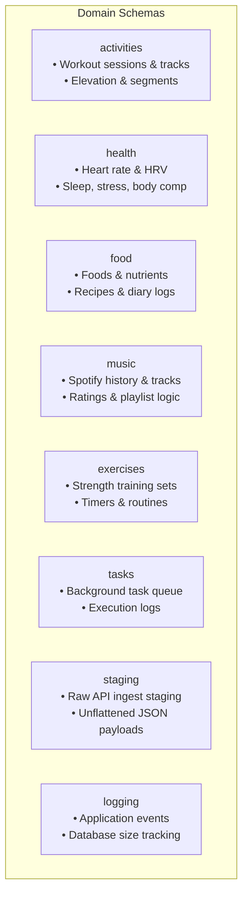

# PostgreSQL Database Principles (`DATABASE_PRINCIPLES.md`)

This document defines the architectural standards, schema organization, query patterns, and operational guardrails for the PostgreSQL layer in PiFitness.

---

## 1. Environment & Operational Isolation

PiFitness strictly isolates development and production databases:

* **Production (PRD):** Runs locally on the Raspberry Pi 5 on the default PostgreSQL port (`5432`). It is never accessed directly by developer or agent workstations via remote connections or SSH.
* **Development (DEV):** Runs in a local Docker container (`pifitness-dev-db`) exposed on `localhost:15432` with database `pifitness_dev` and user `dev`.
* **Database Sync Protocol:** DEV is periodically updated by cloning a verified, sanitized production nightly backup using `tools/db/sync-prod-to-dev.ps1` (executed exclusively by the human developer).
* **Reset Protocol:** DEV can be rapidly reset to a pristine baseline using `tools/db/dev_reset.py` without requiring network transfers.

---

## 2. Schema Organization & Domain Boundaries

PiFitness organizes relational data into domain-specific PostgreSQL schemas rather than dumping all tables into `public`:



* **`activities`:** Stores GPS workout sessions, distance/elevation profiles, courses, and segment matches.
* **`health`:** Stores high-frequency biometric data (heart rate, sleep stages, HRV, body battery, stress).
* **`food`:** Stores food items, macronutrients, recipe definitions, and daily diary logs.
* **`music`:** Stores track metadata, Spotify listening history, track ratings, and playlist configurations.
* **`exercises`:** Stores strength and conditioning exercises, exercise attempts, and active workout timers.
* **`tasks`:** Houses the job registry, scheduled task definitions, and worker execution logs.
* **`staging`:** Temporary landing schema for bulk API ingestion before records are transformed and merged into domain tables.
* **`logging`:** Stores application events, operational audit logs, and database growth metrics.

---

## 3. Query & Performance Patterns

### 1. Keyset Pagination (No Unbounded OFFSET)
High-cardinality tables (e.g. `music.listening_history`, `health.heartrate_raw`, `activities.activity_details`) must use keyset pagination (cursor-based using timestamp or indexed ID) instead of `OFFSET`:
```sql
-- Correct: Keyset pagination leveraging index
SELECT track_id, played_at
FROM music.listening_history
WHERE played_at < %s
ORDER BY played_at DESC
LIMIT 50;

-- Prohibited on large tables:
-- SELECT ... OFFSET 50000 LIMIT 50;
```

### 2. Mandatory Parameterization
Dynamic values must always be bound using driver parameter placeholders (`%s`). String formatting, f-strings, or string concatenation to build SQL statements is strictly prohibited to prevent SQL injection and enable query plan caching.

### 3. Bounded Reads
Endpoints and queries must never execute unbounded `SELECT *` without an explicit `LIMIT`. Application code must enforce maximum page boundaries (e.g. max 100 rows per request).

### 4. Database-Side Computation via Views & Functions
Calculations that aggregate data across time-series rows or complex joins (such as leaderboards, elevation delta calculations, and diary totals) are encapsulated in PostgreSQL views and stored functions (e.g. `activities.vw_segment_leaderboard`, `food.fn_diary_stats`), ensuring consistent calculations across all callers.

---

## 4. Data Integrity & Migration Standards

* **Constraints Over Conventions:** Data integrity is enforced at the database level using `FOREIGN KEY` constraints, `NOT NULL` columns, `CHECK` constraints, and `UNIQUE` indexes. Application code must not rely solely on convention to keep relational state valid.
* **Migration Ledger:** Schema changes are version-controlled in `deploy/migrations/` using timestamped migration scripts. Migrations must be idempotent, tested against the local DEV database, and backward-compatible.
* **Offline Schema Documentation:** The physical schema is automatically reflected in `docs/data/schema.generated.md` via `tools/db/schema_map.py`. This document must be kept in sync whenever migrations alter the schema.
