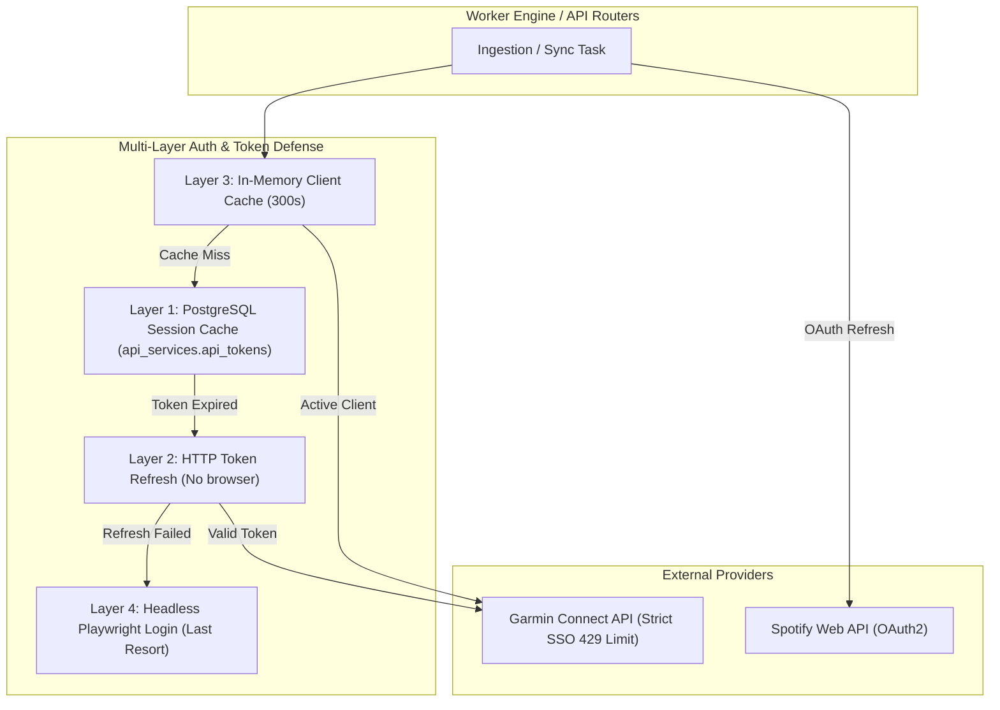

# API, Integration & Worker Principles (`INTEGRATION_PRINCIPLES.md`)

This document defines the architecture, rate-limiting defenses, authentication caching, and background worker design for third-party integrations (Garmin, Spotify) and asynchronous task execution in PiFitness.

---

## 1. External Integration Boundaries

External API integrations live in `backend/pifitness/integrations/`. They act as isolated service gateways with strict defenses against rate limits, session invalidation, and network timeouts.

---

## 2. Garmin Integration: The 3-Layer Anti-429 Defense

Garmin Connect's Single Sign-On (SSO) aggressively enforces rate limits (HTTP 429) against automated browser logins. To ensure continuous sync without account lockout, all Garmin API access must pass through a 4-tier protection strategy:

1. **Layer 3 — In-Memory Client Reuse (Process-Local):**
   * *Mechanism:* Reuses active `GarminClient` instances within a 300-second window in the local Python process.
   * *Benefit:* Eliminates redundant token verification calls during consecutive task executions.
2. **Layer 1 — Database Session Cache (Cross-Process):**
   * *Mechanism:* OAuth and session tokens are persisted in PostgreSQL table `api_services.api_tokens`.
   * *Benefit:* Enables background worker processes, CLI tools, and FastAPI web workers to share authenticated sessions across processes and container restarts without logging in again.
3. **Layer 2 — Pure HTTP Token Refresh (No Browser):**
   * *Mechanism:* When access tokens expire, the client sends a pure HTTP token refresh request using persisted refresh tokens.
   * *Benefit:* Refreshes sessions silently without triggering Cloudflare challenges or browser automation overhead.
4. **Layer 4 — Headless Playwright Login (Emergency Fallback):**
   * *Mechanism:* Only fires when all previous three layers fail (e.g. refresh token has completely expired after weeks of inactivity).
   * *Invariant:* Never initiate automated browser logins on routine synchronization cycles.

---

## 3. Spotify Integration: OAuth Lifecycle & Rate Limits

* **Token Lifecycle:** Spotify API access relies on standard OAuth2 authorization code and refresh token lifecycles stored in `api_services.api_tokens`.
* **Proactive Refresh:** Tokens are inspected before dispatch; if a token is within 5 minutes of expiration, it is refreshed prior to initiating batch track or listening history fetches.
* **429 Backoff & Retry-After:** Ingest routines must respect the `Retry-After` HTTP response header. When a rate limit is encountered, the worker pauses execution rather than immediately retrying and compounding the backoff penalty.
* **ISRC Canonicalization:** Track ingestion reconciles external Spotify IDs with canonical International Standard Recording Codes (ISRCs) in `music.all_tracks` to preserve cross-album history and ratings consistency.

---

## 4. Background Worker Architecture

PiFitness separates long-running API ingestion and batch maintenance from synchronous HTTP request/response loops.

### Task Registry & Queueing (`tasks` Schema)
* **Task Catalog (`tasks.task_info`):** Defines known jobs, their python entry points (`module.function`), target schedules, and default parameter payloads.
* **Task Execution (`tasks.task_execution`):** Records every execution event, start time, completion time, status (`SUCCESS`, `FAILED`, `RUNNING`), affected row counts, and error stack traces.

### Execution Model
1. **Periodic Systemd Timers:** Tasks on fixed intervals (e.g. biometric sync, hardware health monitoring) are triggered via systemd service units on the host (`pifitness_agent.timer`, `pifitness-hardware-health.timer`).
2. **On-Demand Dispatch:** Administrative tasks can be scheduled or triggered manually via the admin router, executing asynchronously in worker threads.
3. **Idempotent Ingestion:** All worker sync functions must be strictly idempotent. Raw ingestion targets `staging` tables or uses `INSERT ... ON CONFLICT DO UPDATE / NOTHING` on domain tables. Rerunning a task must never duplicate records or distort historical aggregations.
