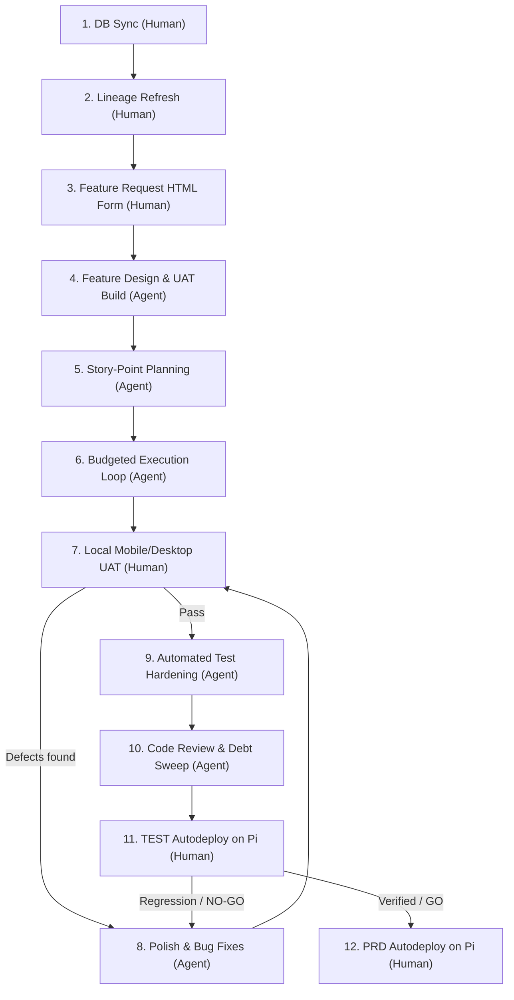

# PiFitness Feature Development Workflow

This is the canonical guide for developing features, enhancements, and bug fixes in PiFitness. It defines the operating model for a single human developer collaborating with AI agents running in Cline, with special guardrails tailored for free and lightweight reasoning models.

---

## 1. Workflow Principles & Invariants

1. **Serial Development:** Exactly one feature is in development at any time across the entire codebase.
2. **Context Preservation for Weaker Models:** Free models degrade rapidly when given broad open-ended prompts, large files, or multi-file objectives. The workflow enforces strict boundary limits:
   - Tasks are sized at **1, 2, or 3 story points** maximum.
   - A single task modifies **at most 3 files**.
   - Every task has **exactly 1 verify command**.
   - State lives in files and sidecars, never in chat memory.
3. **Deterministic Tooling over LLM Improvisation:**
   - Feature requests are generated by an interactive HTML form (`tools/workflow/request_form.html`).
   - UAT checklists are compiled into interactive HTML by `tools/workflow/fd.py uat build`.
   - Data flows and surface impacts are discovered via `tools/data_dictionary/lineage.py`.
   - Progress and task verification are gated by `tools/workflow/fd.py start` and `done`.

---

## 2. Core Tool Suite Awareness

Agents must use the project's dedicated CLI tools instead of inventing ad hoc discovery or manual scripting:

### `tools/workflow/fd.py` (Feature Design & Lifecycle Tool)
The token-efficient CLI manager for feature files. Standard library only; run with project Python.

| Command | Purpose | When Used |
|---|---|---|
| `python tools/workflow/fd.py hot <id>` | Dumps frontmatter, Resume Here, task status, and open questions without dumping entire file. | Session start & orientation. |
| `python tools/workflow/fd.py next <id>` | Identifies the next actionable task, its anchors, and verification command. | Picking next task in execution. |
| `python tools/workflow/fd.py task <id> T##` | Prints exact task block including dependency and file anchors. | Task execution. |
| `python tools/workflow/fd.py brief <id> T##` | Produces resume brief: git status, recent log, and verify output. | Resuming after interruption. |
| `python tools/workflow/fd.py start <id> T##` | Records task start event in `<id>_log.md`. | Mandatory before editing code. |
| `python tools/workflow/fd.py done <id> T##` | **Evidence Gate:** Executes task verify command, records exit code and output, closes task. | Mandatory before task commit. |
| `python tools/workflow/fd.py bug <id> T## "..."` | Records structured bug entry in `<id>_bugs.md` sidecar. | Polish workflow & testing. |
| `python tools/workflow/fd.py backlog add [item]` | Appends out-of-scope finding to `docs/workflow/BACKLOG.md`. | Whenever finding unrelated issues. |
| `python tools/workflow/fd.py uat build <id>` | Compiles Acceptance Criteria from `<id>_design.md` into interactive `<id>_uat.html`. | End of Design / Plan phases. |
| `python tools/workflow/fd.py check <id> --anchors` | Verifies file syntax, frontmatter, and that anchored files/symbols exist. | Design & Plan validation. |

### `tools/data_dictionary/lineage.py` (Data & Application Lineage)
Mandatory first action for database, ETL, API, or frontend data-flow queries.

| Command | Purpose |
|---|---|
| `python tools/data_dictionary/lineage.py describe <target>` | Returns compact lineage report (sources, transforms, consumers, frontend views). |
| `python tools/data_dictionary/lineage.py evidence <source> <target>` | Extracts minimal code snippets documenting writer/consumer relationship. |

### `tools/verify.py` & Quality Tools
- `python tools/verify.py --scope all`: Comprehensive verification gate (backend, frontend, DB, deploy, docs).
- `python tools/lint_comments.py`: Enforces comment hygiene (no task IDs, bug IDs, or history notes).
- `python tools/check_docs.py cites`: Validates all backticked doc paths exist.
- `python tools/db/dev_reset.py`: Fast template-based DEV DB refresh that replays migrations and stamps `pifitness.env='dev'`.

---

## 3. Directory Layout & Asset Lifecycles

```
PiFitness/
├── .features/
│   ├── descriptions/                   # Step 3: Human feature request Markdown
│   │   └── <id>.md
│   ├── designs_active/                 # Steps 4-10: Active working directory
│   │   ├── <id>_design.md              # Technical spec + micro-task plan
│   │   ├── <id>_log.md                 # Append-only progress log (via fd.py)
│   │   ├── <id>_bugs.md                # Bug tracker sidecar (via fd.py)
│   │   ├── <id>_uat.html               # Interactive mobile UAT checklist (generated)
│   │   └── <id>_feedback.md            # Human feedback exported from uat.html
│   ├── designs_complete/               # Step 12: Archived features upon PRD deployment
│   │   └── <id>/
│   └── templates/                      # Clean canonical templates
│       ├── _FEATURE_REQUEST_TEMPLATE.md
│       ├── _FEATURE_DESIGN_TEMPLATE.md
│       └── _FEATURE_FEEDBACK_TEMPLATE.md
│
├── .clinerules/
│   ├── 00-environment.md               # Environment, ports, and command paths
│   ├── 00-tool-constraints.md          # Tool execution & canonical file-writing limits
│   ├── 01-terminal-use.md              # PowerShell 5.1 & long-command rules
│   ├── 10-default-rules.md             # Global Git, DB, and Lineage guardrails
│   └── workflows/                      # Specialized workflow instructions
│       ├── feature-design.md           # Step 4: Design workflow
│       ├── feature-plan.md             # Step 5: Planning & sizing workflow
│       ├── feature-execute.md          # Step 6: Budgeted execution workflow
│       ├── feature-polish.md           # Step 8: Feedback resolution workflow
│       ├── feature-test.md             # Step 9: Test creation workflow
│       └── feature-review.md           # Step 10: Code review & debt cleanup
│
└── tools/
    └── workflow/
        ├── request_form.html           # Local HTML form to author feature requests
        ├── fd.py                       # Feature design & UAT engine
        └── run_long.ps1                # Long-running command launcher
```

---

## 4. The 12-Step Feature Lifecycle



### Step 1: Human Syncs Local DEV Database
- **Actor:** Human.
- **Action:** Runs `tools/db/sync-prod-to-dev.ps1` from PowerShell to refresh local Docker PostgreSQL (`pifitness-dev-db`) from PRD.
- **Verification:** Ensures `ALTER DATABASE pifitness_dev SET pifitness.env = 'dev'` is active (or runs `python tools/db/dev_reset.py`).

### Step 2: Human Refreshes Lineage Graph
- **Actor:** Human.
- **Action:** Runs `python tools/data_dictionary/lineage.py build` (or verify) so local lineage metadata (`docs/lineage/graph.json`) matches current code and database views.

### Step 3: Human Fills Feature Request via HTML Form
- **Actor:** Human.
- **Action:** Opens `tools/workflow/request_form.html` in a web browser. Fills in:
  - Feature ID (e.g. `feat-music-search` or `fix-timer-leak`) and Title.
  - Category: New Capability, Enhancement, or Bug Fix.
  - Problem Statements (P1, P2...): What is missing or broken in non-technical terms.
  - Desired Behavior: How the app should function differently.
  - Affected Surfaces & Known Constraints (e.g., mobile-only, specific screens).
  - Out of Scope / Non-Goals.
- **Output:** Clicks "Export Request", saving to `.features/descriptions/<id>.md`.

### Step 4: Agent Activates Design Workflow
- **Actor:** Agent (invoked via `/feature-design <id>`).
- **Procedure:**
  1. Reads `.features/descriptions/<id>.md`.
  2. Runs `python tools/data_dictionary/lineage.py describe <target>` for all touched surfaces.
  3. Formulates technical architecture, database implications, and API changes (≤250 words).
  4. Writes numbered **Acceptance Criteria (ACs)**. Each AC must include:
     - Clear description of expected behavior.
     - `auto:` verification command or automated assertion.
     - `human:` step-by-step observation on screen or mobile.
  5. Initializes `.features/designs_active/<id>_design.md`.
  6. Runs `python tools/workflow/fd.py uat build <id>` to compile ACs into `.features/designs_active/<id>_uat.html`.
  7. Asks any critical clarifying questions (Open Questions) before planning.

### Step 5: Agent Activates Plan Workflow
- **Actor:** Agent (invoked via `/feature-plan <id>`).
- **Procedure:**
  1. Decomposes the technical spec into serialized micro-tasks (`T01`, `T02`...).
  2. **Strict Sizing Enforcement:**
     - **1 Point:** Trivial / single-file edit or test baseline tweak.
     - **2 Points:** Standard paired change (e.g. backend endpoint + query, or component + hook).
     - **3 Points:** Maximum allowed task complexity (e.g. migration + model + route).
     - *Any task >3 points must be split into multiple smaller tasks.*
  3. **Mandatory Anchors:** Every task lists verified file and symbol anchors (`modify`, `create`, `delete`, `pattern`, `read`). No invented file paths.
  4. Sets exactly one deterministic verify command per task.
  5. Runs `python tools/workflow/fd.py check <id> --anchors` to validate structure.
  6. Updates total feature point estimate in the design frontmatter.

### Step 6: Agent Activates Execute Workflow with Story Point Budget
- **Actor:** Agent (invoked via `/feature-execute <id> [budget]`, e.g. `/feature-execute feat-music-search 4`).
- **Procedure:**
  1. Reads next task using `python tools/workflow/fd.py next <id>`.
  2. Runs `python tools/workflow/fd.py start <id> T##` (records start event).
  3. Implements changes adhering to `.clinerules/00-tool-constraints.md` (≤200-line read limit, targeted edits).
  4. Executes the task verify command.
  5. Runs `python tools/workflow/fd.py done <id> T##` (evidence gate).
  6. Stages changed files + sidecars and creates **exactly one git commit**: `feat(<id>): T## <summary>`.
  7. Decrements budget. If points remain, advances to the next task; otherwise cleanly prints resume status and ends turn.

### Step 7: Human Tests Locally via Interactive UAT
- **Actor:** Human.
- **Action:**
  1. Opens local app on desktop or mobile (`http://localhost:3000`).
  2. Opens `.features/designs_active/<id>_uat.html` in browser.
  3. Walks through each Acceptance Criterion, clicking **[Pass]** or **[Fail]** and adding notes for unexpected behavior.
  4. Clicks **"Export Feedback Markdown"**, saving output to `.features/designs_active/<id>_feedback.md`.

### Step 8: Agent Activates Polish Workflow
- **Actor:** Agent (invoked via `/feature-polish <id>`).
- **Condition:** Only triggered if human recorded failures in Step 7.
- **Procedure:**
  1. Reads `.features/designs_active/<id>_feedback.md`.
  2. For each failed AC, logs a bug using `python tools/workflow/fd.py bug <id> T## "description" --ac AC-#`.
  3. Implements targeted fixes, verifies, and records resolution.
  4. Human re-verifies via `uat.html`. When all ACs pass, proceeds to Step 9.

### Step 9: Agent Activates Test Workflow
- **Actor:** Agent (invoked via `/feature-test <id>`).
- **Procedure:**
  1. Audits code changes across backend and frontend.
  2. Writes or updates automated tests for new functionality.
  3. Decorates all new tests with approved pytest markers: `@pytest.mark.invariant`, `@pytest.mark.contract`, `@pytest.mark.smoke`, or `@pytest.mark.journey`.
  4. Confirms tests never mock the unit under test.
  5. Runs `python tools/verify.py --scope all` to ensure zero regressions against baselines.

### Step 10: Agent Activates Code Review Workflow
- **Actor:** Agent (invoked via `/feature-review <id>`).
- **Procedure:**
  1. Inspects `git diff main...HEAD --stat` to verify every modified file matches `docs/REPO_MAP.md`.
  2. Runs `python tools/lint_comments.py` to ensure zero task/bug IDs or history comments exist in source code.
  3. Runs `python tools/check_docs.py cites` to verify doc consistency.
  4. Removes any temporary, scratch, or untracked build artifacts.
  5. Sets feature status to complete: `python tools/workflow/fd.py set <id> feature complete`.

### Step 11: Human Deploys to TEST via Pi Autodeploy Launcher
- **Actor:** Human.
- **Action:**
  1. Push the branch: `git push origin agent/feature-<id>:feature-test`.
  2. Launch bootstrap on the Raspberry Pi (or run `deploy/run-bootstrap.ps1`), selecting `TEST`.
  3. The launcher invokes `autodeploy.sh --environment test --commit <SHA>`, running the 10-step sequence:
     - Steps 1–6 (while PRD is still running): Preflight check, clean TEST app checkout (`/home/god/PiFitness-test`), dependency sync via `uv sync` & `npm ci`, DB prepare / clean baseline capture, pending migrations applied via `dbmate up`, and in-process regression tests (pytest + vitest).
     - Steps 7–9 (cutover): Stops PRD units/timers, starts TEST services on normal ports (`:8000`, `:3000`), runs smoke tests against the running TEST stack.
     - Step 10: Manual test gate.
  4. Human walks the feature on phone over HTTPS (`https://pifitness.duckdns.org`) using `uat.html`.
  5. If issues are found: human enters `NO-GO`; `autodeploy.sh` automatically halts TEST, restores PRD services, and returns to Step 8 (Polish).
  6. If verified: human enters `GO`; `autodeploy.sh` halts TEST and restores PRD services.

### Step 12: Human Deploys to Production via Pi Autodeploy Launcher
- **Actor:** Human.
- **Action:**
  1. Locally merges `agent/feature-<id>` into `main` with `--no-ff`.
  2. Creates and pushes an immutable release tag: `git tag prd-YYYYMMDD` && `git push origin main --tags`.
  3. Launches bootstrap on the Raspberry Pi, selecting `PRD`.
  4. The launcher invokes `autodeploy.sh --environment prd --commit <SHA>`, executing the 9-step zero-prompt sequence:
     - Read-only preflight.
     - Gracefully stops PRD services and records active units/timers.
     - Atomically swaps clean PRD checkout in `/home/god/PiFitness`.
     - Reconciles dependencies outside app dir.
     - Captures PRD rollback baseline dump (`prd_baseline_<ts>.dump`) if migrations pending.
     - Applies pending migrations via `dbmate up`.
     - Starts PRD services and verifies public health URL.
     - Runs regression tests and live smoke tests against the deployed production stack.
     - On any failure: automatic exit handler rolls back code, units, and database to baseline.
  5. Moves `.features/designs_active/<id>*` into `.features/designs_complete/<id>/`.

---

## 5. Story Point Sizing Matrix

To protect weaker models from context collapse, tasks are strictly capped:

| Points | Complexity | Typical File Scope | Example |
|---|---|---|---|
| **1 pt** | Trivial | 1 file | Fix a CSS class, correct a label, add an index, or update a baseline. |
| **2 pts** | Standard | 2 files | Add a FastAPI endpoint + query, or a React UI component + helper function. |
| **3 pts** | Complex | 3 files (Max) | DBMate migration + model + router, or component + hook + test suite. |
| **>3 pts** | Prohibited | N/A | **Must be split into multiple smaller tasks during the Plan phase.** |

---

## 6. Git Branching & Commit Conventions

- **Branch Name:** `agent/feature-<id>` cut directly from `main`.
- **Agents:** Never run `git push`, `git merge`, `git checkout`, or branch-switching commands.
- **Commit Cadence:** Exactly **one commit per completed task**.
- **Commit Message Format:**
  ```text
  feat(<feature-id>): T## <concise summary of task completed>
  ```
- **Commit Integrity:** The commit must bundle the task code changes and the updated `.features/designs_active/<id>_log.md` sidecar in the exact same commit. Never create separate code and log commits.
