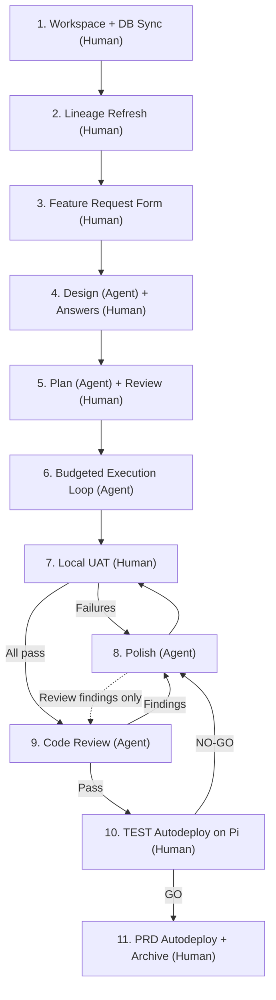

# PiFitness Feature Development Workflow

This is the canonical guide for developing features, enhancements, and bug fixes in PiFitness. It defines the operating model for a single human developer collaborating with AI agents running in Cline, with special guardrails tailored for free and lightweight reasoning models.

The tools (`fd.py`, `lineage.py`) are canonical. Instructions and templates follow what the tools do.

---

## 1. Workflow Principles & Invariants

1. **Serial Development:** Exactly one feature is in development at any time across the entire codebase, on the single `feature-test` branch.
2. **Context Preservation for Weaker Models:** Free models degrade rapidly when given broad open-ended prompts, large files, or multi-file objectives. The workflow enforces strict boundary limits:
   - Tasks are sized at **1, 2, or 3 story points** maximum.
   - A single task touches **at most as many files as it has points** (never more than 3).
   - Every task has **exactly 1 verify command**.
   - State lives in files and sidecars, never in chat memory.
3. **Chat is not a record.** Open-question answers, decisions, and approvals exist only when written in the design file (or, before a design exists, the request). An agent never acts on an answer that exists only in chat.
4. **Deterministic Tooling over LLM Improvisation:**
   - Feature requests are generated by an interactive HTML form (`tools/workflow/request_form.html`, served by `request_form.py`).
   - UAT checklists are compiled into `tools/workflow/uat.json` by `fd.py uat build` and served by `tools/workflow/uat_launcher.py`.
   - Data flows and surface impacts are discovered via `tools/data_dictionary/lineage.py`.
   - Task progress is recorded by `fd.py start`, `done`, and `set`.
5. **Agents never stage or commit and never pass `--force`.** The human reviews and commits.
6. **Open questions stop everything.** Any agent workflow that runs after `/feature-design` (plan, execute, polish, review) stops immediately while any open question is unresolved.
7. **Agents do not test.** They are not asked to write tests, and they do not run the full suite. The human tests locally (Step 7), and the autodeploy bootstrap runs the regression and smoke tests (Step 10). The only tests a feature adds are the human-approved `new test` lines in the design (section 7).

---

## 2. Core Tool Suite Awareness

Agents must use the project's dedicated CLI tools instead of inventing ad hoc discovery or manual scripting. Run everything from the repo root.

### `tools/workflow/fd.py` (Feature Design & Lifecycle Tool)

Standard library only. `<id>` is the feature id; agents find it from the single `*_design.md` in `.features/designs_active/`. It reads, writes, and updates files. It does not interpret answers or make decisions; that stays with the agent and the human.

| Command | Purpose | Used in |
|---|---|---|
| `fd.py check <id> [--anchors]` | Validates structure. `--anchors` also verifies that anchored files and symbols exist. Errors on bad Points or too many files per task. | Design, Plan |
| `fd.py oq <id> [--open\|--unanswered]` | Prints open-question blocks. `--open` = status not resolved. `--unanswered` = Answer still the placeholder. | Design, Plan |
| `fd.py section <id> [name]` | Prints one section by heading; no name lists sections. | Design, Plan |
| `fd.py uat build <id>` | Compiles Acceptance Criteria into `tools/workflow/uat.json` (read by `uat_launcher.py`). | Design |
| `fd.py set <id> resume` | Recomputes Resume Here (`progress`, `next`, `blocked-by`) and the frontmatter `points:` total. | Plan, Execute |
| `fd.py hot <id> [--brief]` | Frontmatter, Resume Here, task table, open questions. | Plan onward |
| `fd.py next <id>` | Next executable task with its anchors. Prints `ACTION: stop` while any OQ is open. | Execute |
| `fd.py task <id> T## [...]` | Prints exact task blocks. | Execute |
| `fd.py brief <id> T##` / `fd.py resume <id>` | Resume context: status, recent log, git status, verify run. | Execute (after interruption) |
| `fd.py start <id> T##` | Records a start entry in `<id>_log.md`. Mandatory before editing code. | Execute |
| `fd.py done <id> T##` | Runs the task's Verify command and records exit code and output tail. Refuses without a prior start. Does **not** change the task's status. | Execute |
| `fd.py set <id> T## <todo\|interrupted\|complete>` | Sets task status. Refuses while the feature is `draft`. Moves the feature `reviewed` → `in-progress` automatically. | Execute |
| `fd.py set <id> feature <draft\|reviewed\|in-progress\|complete>` | Sets feature status. `complete` requires all tasks complete, every AC box ticked, and no unresolved bug. | Human, see section 5 |
| `fd.py log <id> ["text"] [-n N]` | Appends to or reads the append-only log. | All |
| `fd.py bug <id> "summary" [--symptom text] [--ac AC-#] [--task T##]` | Records a bug (status `open`) in `<id>_bugs.md`. UAT bugs link an AC; review findings link nothing. Rejected while the same AC already has an unresolved bug. | Polish, Review |
| `fd.py bugs <id> [--unresolved\|--show BUG-#\|all]` | Lists bugs, or prints one or all. | Polish, Review |
| `fd.py bugs <id> --update BUG-# [--root-cause T] [--fix T] [--status S]` | Fills the diagnosis and moves a bug through its lifecycle (section 6, Bug lifecycle). `in-review` needs a root cause and a fix. A bug linked to an AC can only be settled by `uat import --apply`. | Polish, Review |
| `fd.py uat import <id> [path] [--apply]` | Parses `<id>_feedback.md` and prints per-AC results, the human's notes, and a summary. With `--apply` it also ticks the box of every passing AC, unticks the rest, and settles `in-review` bugs linked to an AC: `fixed` if the AC passed, `not-fixed` if it failed, unchanged if the feedback is older than the fix. Safe to repeat. | Human, Polish, Review |
| `fd.py backlog add <item>` | Appends an out-of-scope finding to `docs/workflow/BACKLOG.md`. | Any |

Before `/feature-plan` adds tasks, `next`, `resume`, and `set` refuse to run and `hot` reports an error ("no `### T##` blocks"). The design workflow therefore uses only `check`, `oq`, `section`, and `uat build`, and edits Resume Here by hand.

### `tools/data_dictionary/lineage.py` (Data & Application Lineage)

Mandatory first action for database, ETL, API, or frontend data-flow queries. Agents only query; they never run `build`.

| Command | Purpose |
|---|---|
| `lineage.py describe <node>` | Compact report: identity, population, upstream, consumers, map, coverage. Bare names resolve for tables and functions; screens and endpoints use ids such as `page:/runs`, `endpoint:GET /api/runs`. |
| `lineage.py search <words...>` | Finds node ids. Use it when `describe` exits 2 (no match, or ambiguous). |
| `lineage.py trace <node> [--up\|--down] [--files]` | Walks the chain; `--files` lists the file:line ranges. |
| `lineage.py evidence <node> [--related-to <node>]` | Minimal source snippets for a node or one relationship. |
| `lineage.py show <node>` | One node and its edges. |
| `lineage.py check` | Lineage health report. |
| `lineage.py build` | **Human only.** Rebuilds `docs/lineage/graph.json` from code and the DEV database catalog. |

A query prints `WARNING graph may be stale` on stderr when code changed since the build. Agents report it in their reply and carry on; they do not rebuild.

### `tools/verify.py` & Quality Tools
- `python tools/verify.py --scope all`: Comprehensive verification gate (backend, frontend, DB, deploy, docs). Run by the human, not by agents.
- `python tools/lint_comments.py`: Enforces comment hygiene (no task IDs, bug IDs, or history notes). Run by `/feature-review`.
- `python tools/check_docs.py cites`: Validates all backticked doc paths exist. Run by `/feature-review`.
- `python tools/db/dev_reset.py`: Fast template-based DEV DB refresh that replays migrations and stamps `pifitness.env='dev'`.

---

## 3. Directory Layout & Asset Lifecycles

```
PiFitness/
├── .features/
│   ├── descriptions/                   # Step 3: the one active feature request
│   │   └── <id>.md
│   ├── designs_active/                 # Steps 4-10: the one active feature's files
│   │   ├── <id>_design.md              # Design, acceptance criteria, open questions, task plan
│   │   ├── <id>_log.md                 # Append-only progress log (via fd.py)
│   │   ├── <id>_bugs.md                # Bug tracker sidecar (via fd.py): open, in-review, not-fixed, fixed
│   │   └── <id>_feedback.md            # Human UAT results (see Step 7)
│   ├── designs_complete/               # Step 11: archived by the human
│   │   └── <id>/
│   └── templates/
│       ├── _FEATURE_REQUEST_TEMPLATE.md
│       └── _FEATURE_DESIGN_TEMPLATE.md
│
├── docs/
│   ├── lineage/graph.json              # Built by the human; queried by agents
│   └── workflow/BACKLOG.md             # Out-of-scope findings (fd.py backlog add)
│
├── .clinerules/
│   ├── 00-environment.md               # Environment, ports, and command paths
│   ├── 00-tool-constraints.md          # Tool execution & canonical file-writing limits
│   ├── 01-terminal-use.md              # PowerShell 5.1 & long-command rules
│   ├── 10-default-rules.md             # Global Git, DB, and Lineage guardrails
│   └── workflows/
│       ├── feature-design.md           # Step 4
│       ├── feature-plan.md             # Step 5
│       ├── feature-execute.md          # Step 6
│       ├── feature-polish.md           # Step 8
│       └── feature-review.md           # Step 9
│
└── tools/
    ├── data_dictionary/lineage.py      # Lineage graph build and query
    └── workflow/
        ├── request_form.py             # Serves the request form and writes the request file
        ├── request_form.html           # The request form UI
        ├── fd.py                       # Feature design, lifecycle, and UAT engine
        ├── uat_launcher.py             # Serves the UAT form and writes <id>_feedback.md
        ├── uat_launcher.html           # The UAT form UI (generic; reads /api/data at runtime)
        ├── uat.json                    # Evergreen AC data written by fd.py uat build; read by uat_launcher.py
        ├── run_long.ps1                # Long-running command launcher
```

---

## 4. Git Rules

- There is one working branch: **`feature-test`**. All agent work happens on it. The human keeps it up to date with `main` between features.
- Every agent workflow starts with `git branch --show-current`. If it does not print `feature-test`, the agent stops and tells the human.
- **Agents' git access is an allowlist:** `git branch --show-current`, `git status`, `git diff`, `git log`, `git show`. Anything else, including staging, is off limits.
- **The human commits**, at whatever cadence suits them. Recommended: review the diff and commit after each execution session, with message `feat(<id>): T01-T03 <summary>`, including `.features/designs_active/<id>_*` so the log and design status travel with the code.
- The human pushes `feature-test` for TEST deployment, merges it into `main` with `--no-ff`, tags `main`, and pushes.
- `main` appears in agent-facing text in one place only: the read-only baseline `git diff main --stat` in Step 9.

---

## 5. Status & Handoff Markers

Each phase leaves markers in files; the next phase checks them before doing anything.

| Marker | Where | Set by |
|---|---|---|
| Request saved | `.features/descriptions/<id>.md` | Human, via the form |
| `status: draft` | design frontmatter | `/feature-design` (template) |
| OQ `Answer:` written | design `## Open Questions` | **Human**, in the file |
| OQ `Decision` + `Status: resolved` | design `## Open Questions` | `/feature-design`, after judging the written answer sufficient (otherwise it rewrites the question and leaves it open) |
| "Design ready." | last agent reply; `blocked-by: none` | `/feature-design` |
| Task Plan, `points:`, Resume Here | design | `/feature-plan` (`fd.py set <id> resume`) |
| `status: reviewed` | design frontmatter | **Human**: `fd.py set <id> feature reviewed` |
| `status: in-progress` | design frontmatter | `fd.py` automatically, on first `set T## complete` or `interrupted` |
| Task `start` / `done` entries | `<id>_log.md` | `fd.py start` / `fd.py done` |
| Task `Status: complete` | design | Agent, `fd.py set <id> T## complete`, only after a `done` with exit 0 |
| `<id>_feedback.md` | designs_active | Human UAT (Step 7) |
| AC boxes `- [x]` | design `## Acceptance Criteria` | `fd.py uat import <id> --apply`, from the human's feedback (the human runs it after UAT; polish and review run it again) |
| Bug status | `<id>_bugs.md` | `fd.py` only: `open` and `in-review` by polish, `fixed` and `not-fixed` from UAT feedback or a review re-check (see Bug lifecycle) |
| Phase notes (`polish:`, `review:`) | `<id>_log.md` | Agent, `fd.py log <id> "..."` |
| `status: complete` | design frontmatter | **Human**, Step 11: `fd.py set <id> feature complete` |

---

## 6. The 11-Step Feature Lifecycle



Each step lists what it **expects** on entry and what it **leaves** on exit. Agent workflows take no id argument: they find it from the single file in the folder.

### Step 1: Human Prepares Workspace and Syncs DEV Database
- **Actor:** Human.
- **Action:**
  1. Check out `feature-test` and bring it up to date with `main`.
  2. Run `tools/db/sync-prod-to-dev.ps1` from PowerShell to refresh local Docker PostgreSQL (`pifitness-dev-db`) from PRD.
  3. Confirm `ALTER DATABASE pifitness_dev SET pifitness.env = 'dev'` is active (or run `python tools/db/dev_reset.py`).
- **Leaves:** `git branch --show-current` prints `feature-test`; DEV database marked `dev`.

### Step 2: Human Refreshes Lineage Graph
- **Actor:** Human.
- **Action:** Runs `python tools/data_dictionary/lineage.py build`, then `lineage.py check`, so `docs/lineage/graph.json` matches current code and database views.
- **Leaves:** a fresh graph.

### Step 3: Human Fills Feature Request via the Form
- **Actor:** Human.
- **Action:** Runs `python tools/workflow/request_form.py` (it opens the form in a browser; opening the HTML file directly does not work). Fills in:
  - Title, Category (New Capability, Enhancement, Bug Fix), and Feature ID (suggested as `feat-` or `fix-` plus a slug).
  - Problem: what is missing or broken, in plain words.
  - What good looks like: one thing you could see or do per line (B1, B2, ...).
  - Out of scope, Known context, and Open questions (all optional).
  - Clicks **Save request**.
- **Leaves:** `.features/descriptions/<id>.md`. That folder holds only this file.
- **Note:** Questions you cannot answer yet go in the request's Open questions. You answer them later, in the design file. If you already know an answer, fold it into a B# or the context and save the request again before running `/feature-design`.

### Step 4: Design (`/feature-design`) and Written Answers
- **Actor:** Agent, then Human, repeating.
- **Expects:** branch `feature-test`; exactly one description file; no design for another feature.
- **Procedure:** The workflow is re-runnable.
  1. **First run:** creates `<id>_design.md` from the template and writes OQ-1 (Confirm understanding) plus one open OQ per question in the request. If the request had questions, it stops there, without researching or drafting.
  2. **Human:** opens the design file and writes each answer on its `Answer:` line, in free text (or `default` to accept the agent's default). Saves. Runs `/feature-design` again. An answer typed only in chat is ignored.
  3. **Re-run:** reads each written answer and judges it. A sufficient answer is resolved (`Decision` and `Status` set). An insufficient one is folded into a rewritten question, with `Answer` reset, so you can see what is still missing. A question with no answer stays open. Once only OQ-1 is open, it maps surfaces with `lineage.py describe`, writes Architecture (≤250 words) and Acceptance Criteria, adds new OQs for every guess it would otherwise make, runs `fd.py check <id>` and `fd.py uat build <id>`, and stops.
  4. Repeat steps 2 and 3 until no OQ is open.
- **Acceptance Criteria format:** each AC line is the human's UAT step (`do -> see (covers B#)`, checked at 360×740 and 448×875 for UI). Each has one `auto:` line: an existing command or test, `new test <path>::<name> [marker]`, or `none (reason)`. See section 7.
- **Leaves:** design with `status: draft`, every OQ resolved, `blocked-by: none`, `tools/workflow/uat.json` built, and the reply "Design ready."
- **Changing the request later:** the request is frozen once the design exists. To change it, delete the design file and start again from Step 3. A scope correction can instead be written as OQ-1's answer; once OQ-1 is resolved, its Decision overrides the request.

### Step 5: Plan (`/feature-plan`) and Human Review
- **Actor:** Agent, then Human.
- **Expects:** no open OQ; no `### T##` blocks yet.
- **Procedure:**
  1. Decomposes the design into 3 to 12 micro-tasks (`T01`, `T02`, ...). Sizing rules are in section 8.
  2. Every task lists verified anchors (`modify`, `create`, `delete`, `pattern`, `read`, `planned`). No invented paths.
  3. Every task has `Points: 1|2|3` and exactly one Verify command.
  4. Runs `fd.py set <id> resume` (writes `points:` and Resume Here) and `fd.py check <id> --anchors` (0 errors, 0 warnings, 0 bad, 0 unresolved).
- **Human:** reviews the plan, then runs `python tools/workflow/fd.py set <id> feature reviewed`. This is the approval marker; `fd.py set T## ...` refuses while the status is `draft`.
- **Leaves:** `status: reviewed`.

### Step 6: Execute (`/feature-execute <budget>`)
- **Actor:** Agent. `<budget>` is a number of story points.
- **Expects:** branch `feature-test`; status `reviewed` or `in-progress`; `fd.py next <id>` shows `blocked-by: none`.
- **Procedure (per task):**
  1. `fd.py next <id>`. If it prints `next: none`, all tasks are done: stop. If it prints `ACTION: stop`, stop. If the task is `interrupted`, or the log shows a `start` for it with no `done`, run `fd.py brief <id> T##` first. If the task's points exceed the budget left, do not start it.
  2. `fd.py start <id> T##`.
  3. Make the change, within the task's anchors and `.clinerules/00-tool-constraints.md` (≤200-line reads, targeted edits). Create test files only as section 7 allows.
  4. `fd.py done <id> T##`. It runs the Verify command and records the result.
  5. If `done` exits 0, run `fd.py set <id> T## complete`. If not, fix and re-run `done`; after three failed runs, treat the task as blocked. If blocked, run `fd.py set <id> T## interrupted`, record why with `fd.py log <id> "T## blocked: ..."`, and stop. A task that cannot be done inside its anchors is a plan problem for the human; the agent never edits the plan or touches unanchored files.
  6. Subtract the task's points from the budget. If points remain, take the next task. Otherwise stop.
  7. If the work needs a decision, add an open OQ to the design file, run `fd.py set <id> resume` (any open OQ blocks `next`), and stop. The human answers in the file and runs `/feature-design`, which resolves it and tells them to re-run `/feature-execute`.
- **No git writes.** At the end of the session the agent prints `git status --porcelain` and the line "Next: `fd.py resume <id>`".
- **Human:** reviews the diff and commits (section 4).
- **Leaves:** completed tasks with start and passing done entries in `<id>_log.md`; uncommitted changes.

### Step 7: Human Tests Locally via UAT
- **Actor:** Human.
- **Expects:** every task complete (`fd.py hot <id> --brief`); the local app running (`http://localhost:3000`); `tools/workflow/uat.json` current (rebuilt by the last `fd.py uat build <id>`).
- **Action:** Runs `python tools/workflow/uat_launcher.py` (opens a browser automatically). For each Acceptance Criterion:
  - Expands the section to read the specific test instructions.
  - Tests in the frontend or via DataGrip for backend-only criteria.
  - Taps **Pass** or **Fail** next to the feature name and fills in observed behaviour.
  - Clicks **Save & import feedback** when done.
- **Leaves:**
  - `.features/designs_active/<id>_feedback.md` written directly by the launcher (no Downloads-folder step).
  - `fd.py uat import <id> --apply` run automatically by the launcher; AC boxes ticked/unticked and UAT bugs settled.
  - The import summary is shown in the browser.
- **Feedback format** (written by the launcher; parsed by `fd.py uat import`):

  ```
  | AC | Result | Notes |
  |---|---|---|
  | AC-1 | Pass | |
  | AC-2 | Fail | timer still runs after back gesture |
  ```

  `Result` is `Pass`, `Fail`, or `Pending`. Every AC id must exist in the design.

### Step 8: Polish (`/feature-polish`)
- **Actor:** Agent. Runs after a UAT with at least one Fail, after Step 9 logs findings, or after a TEST NO-GO.
- **Expects:** branch `feature-test`; no open OQ; status `in-progress`; every task complete; `<id>_feedback.md` exists.
- **Procedure:**
  1. `fd.py uat import <id> --apply` syncs the AC boxes and settles bugs that were waiting on UAT.
  2. For each failed AC with no unresolved bug, `fd.py bug <id> "summary" --symptom "<feedback note>" --ac AC-#`.
  3. For each bug that is `open` or `not-fixed`: diagnose the root cause, fix it with targeted changes in whatever files it needs, then `fd.py bugs <id> --update BUG-# --root-cause "..." --fix "...; files: <paths>" --status in-review`. A bug that is `not-fixed` keeps its earlier attempt in the record, so the agent does not repeat it.
  4. If a fix needs a decision, add an open OQ to the design file and carry on with the bugs it does not affect. The human answers in the file and runs `/feature-design`, then re-runs `/feature-polish`.
  5. `fd.py log <id> "polish: ..."`. No commits.
- **Polish does not prove a fix.** It writes no tests and runs no suite. The human's UAT decides whether a fix worked.
- **Leaves:** bugs `in-review`; uncommitted changes. The human commits, re-runs UAT (Step 7), saves the feedback, and runs `fd.py uat import <id> --apply`. Bugs found by Step 9 have no AC, so Step 9 is re-run to confirm them. This loop repeats until nothing is unresolved.

### Step 9: Code Review (`/feature-review`)
- **Actor:** Agent.
- **Expects:** branch `feature-test`; no open OQ; status `in-progress`; every task complete; `fd.py uat import <id> --apply` shows 0 fail and 0 pending; no bug linked to an AC unresolved; no bug `open` or `not-fixed`. If not, it stops and says what the human must do. That is a gate, not a finding.
- **Procedure:** review reports and fixes nothing. It runs no tests.
  1. Account for every changed or untracked file (`git status --porcelain`, `git diff main --stat`): each must be a task anchor, a file named in a bug's Fix, or a feature housekeeping file.
  2. Run `python tools/lint_comments.py` and `python tools/check_docs.py cites`.
  3. **Test growth:** each new test file or function must trace to an AC `auto:` line that says `new test`. Do not delete it.
  4. **Evidence audit:** read `fd.py log <id> -n 200`. Every complete task needs a `start` and a latest `done` with `exit=0`; `forced` is not a pass. Report gaps; do not repair them.
  5. Re-check the review bugs from an earlier run that are `in-review`: gone means `fixed`, found again means `not-fixed`.
  6. Log each finding with `fd.py bug <id> "summary" --symptom "..."`.
  7. `fd.py log <id> "review: PASS"` or `"review: FAIL (<n> findings: ...)"`. It passes only when no bug is unresolved.
- **Does not** set the feature `complete`.
- **Leaves:** on FAIL, the findings logged as bugs and the human told; the human runs `/feature-polish` and then `/feature-review` again. On PASS, a clean tree ready for the human to commit.

#### Bug lifecycle

| Status | Meaning | Set by |
|---|---|---|
| `open` | Recorded, not yet fixed. | `fd.py bug`: polish for a failed AC, review for a finding |
| `in-review` | An agent diagnosed and fixed it and is waiting for verification. Needs a root cause and a fix on record. | Polish: `fd.py bugs --update --status in-review` |
| `fixed` | Verified. | A bug linked to an AC: `fd.py uat import --apply`, when that AC passes in feedback newer than the fix. A review finding: Step 9, when it no longer reproduces. |
| `not-fixed` | Verification failed. Polish picks it up again. | The same two routes, when the AC fails again or the finding is still there. |

A bug linked to an AC is verified only by the human's UAT. No agent can mark it fixed.

### Step 10: Human Deploys to TEST via Pi Autodeploy Launcher
- **Actor:** Human.
- **Action:**
  1. Commit everything on `feature-test` (code, tests, `.features/designs_active/<id>_*`).
  2. Push it: `git push origin feature-test`.
  3. Launch bootstrap on the Raspberry Pi (or run `deploy/run-bootstrap.ps1`), selecting `TEST`.
  4. The launcher invokes `autodeploy.sh --environment test --commit <SHA>`, running the 10-step sequence:
     - Steps 1–6 (while PRD is still running): Preflight check, clean TEST app checkout (`/home/god/PiFitness-test`), dependency sync via `uv sync` & `npm ci`, DB prepare / clean baseline capture, pending migrations applied via `dbmate up`, and in-process regression tests (pytest + vitest).
     - Steps 7–9 (cutover): Stops PRD units/timers, starts TEST services on normal ports (`:8000`, `:3000`), runs smoke tests against the running TEST stack.
     - The launcher's own step 10: manual test gate.
  5. Walks the feature on a phone over HTTPS (`https://pifitness.duckdns.org`) using the AC list.
  6. **NO-GO:** `autodeploy.sh` halts TEST and restores PRD. The human records the failures as `Fail` rows in `<id>_feedback.md` (using the UAT launcher or by hand), runs `fd.py uat import <id> --apply`, and then runs `/feature-polish`.
  7. **GO:** `autodeploy.sh` halts TEST and restores PRD.

### Step 11: Human Deploys to Production and Archives
- **Actor:** Human.
- **Action:**
  1. Merge `feature-test` into `main` with `--no-ff`.
  2. Create and push an immutable release tag: `git tag prd-YYYYMMDD`, then `git push origin main --tags`.
  3. Launch bootstrap on the Raspberry Pi, selecting `PRD`.
  4. The launcher invokes `autodeploy.sh --environment prd --commit <SHA>`, executing the 9-step zero-prompt sequence:
     - Read-only preflight.
     - Gracefully stops PRD services and records active units/timers.
     - Atomically swaps clean PRD checkout in `/home/god/PiFitness`.
     - Reconciles dependencies outside app dir.
     - Captures PRD rollback baseline dump (`prd_baseline_<ts>.dump`) if migrations pending.
     - Applies pending migrations via `dbmate up`.
     - Starts PRD services and verifies public health URL.
     - Runs regression tests and live smoke tests against the deployed production stack.
     - On any failure: automatic exit handler rolls back code, units, and database to baseline.
  5. After PRD succeeds, run `python tools/workflow/fd.py set <id> feature complete`. It requires every task complete, every AC ticked, and no unresolved bug.
  6. **Archive manually.** Move `.features/designs_active/<id>_*` and `.features/descriptions/<id>.md` into `.features/designs_complete/<id>/`. Both source folders must end up empty, or the next `/feature-design` stops.
  7. Bring `feature-test` back up to date with `main`.

---

## 7. Test Discipline

Agents must not leave a pile of feature-specific tests behind for pytest to run forever.

1. **One allowlist.** The `auto:` lines in the design's Acceptance Criteria are the complete list of new tests a feature may add. `auto:` is an existing command (preferred), `new test <path>::<name> [marker]`, or `none (reason)`. A `new test` line appears only after the human approved it in a written answer to an open question whose default is no. Delivering the feature is the priority; tests are the exception.
2. **New tests only guard lasting rules** that other features could break: invariants, contracts, smoke paths, journeys. Not one-off implementation details, not "this task's code was written".
3. **Where tests are created.** Step 5 plans a test file only for an AC marked `new test`; Step 6 creates it in that task; no later step adds tests. Extending an existing test file beats creating one. An existing test that this change breaks may be updated.
4. **Quality.** Each new test has a docstring and one V2 marker, is named for the behavior it guards (never the feature id, task id, or "feature_x"), does not mock the unit under test, and does not duplicate existing coverage.
5. **No scratch.** Throwaway scripts, snapshot dumps, and temporary tests are never left in the repository.
6. **Task Verify commands** are existing commands, or the AC's `auto:` command. A task never exists only to write tests.
7. **Review audits it** (Step 9, test growth). A test that traces to no `new test` AC is logged as a bug; review does not delete it.

---

## 8. Story Point Sizing Matrix

To protect weaker models from context collapse, tasks are strictly capped. `fd.py check` enforces this table.

| Points | Files | Example |
|---|---|---|
| **1 pt** | 1 | Fix a CSS class, correct a label, add an index. |
| **2 pts** | up to 2 | Add a FastAPI endpoint + query, or a React component + helper function. |
| **3 pts** | up to 3 (max) | DBMate migration + model + router, or component + hook + helper. |
| **>3 pts** | Prohibited | Must be split into smaller tasks during Step 5. |

A `planned` anchor counts as a file even though `fd.py check` does not count it.

---

## 9. Pending Tooling & Known Tool Behavior

Items to build or watch. Each says what the earlier step must leave so the fix can drop in.

| Item | Step | What the prior step leaves | Fix or expectation |
|---|---|---|---|
| **Branch guard** | all agent steps | n/a | Add the allowlist in section 4 to `.clinerules/10-default-rules.md` (wording in `git-guard-snippet.md`) so it holds for every workflow. Prose cannot stop a mistake. If you want a hard stop, look at a `pre-commit` hook that refuses unless an environment variable that only you set is present, or at your Cline version's command permission settings. |
| **Done evidence** | 6, 9 | `start` and `done` log entries | `fd.py done` does not close a task and `fd.py set T## complete` does not check the log. The Step 9 evidence audit catches fake completions. If needed later, make `set complete` require a `done` entry with exit 0. |
| **Test-growth check** | 9 | AC `auto:` lines | A tool that compares new test files and functions (from `git`) with the AC `auto:` lines. Until then the review agent does it by reading. |
| **`planned` anchors** | 5 | n/a | `fd.py check` ignores them when counting files. The planner counts them by hand. |
| **Design-phase tools** | 4 | n/a | `next`, `resume`, and `set` refuse until tasks exist and `hot` reports an error, so the design workflow edits Resume Here by hand until a Task Plan exists. |
| **`backlog add`** | any | `docs/workflow/BACKLOG.md` with a 7-column table | It appends `id, item, source, suggested phase, size, status, phase`, using `-` for the two phase columns. Keep the file's header in that shape. |
